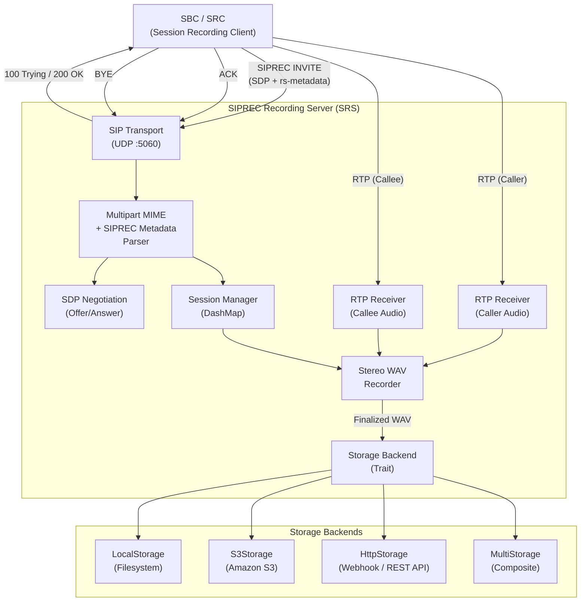
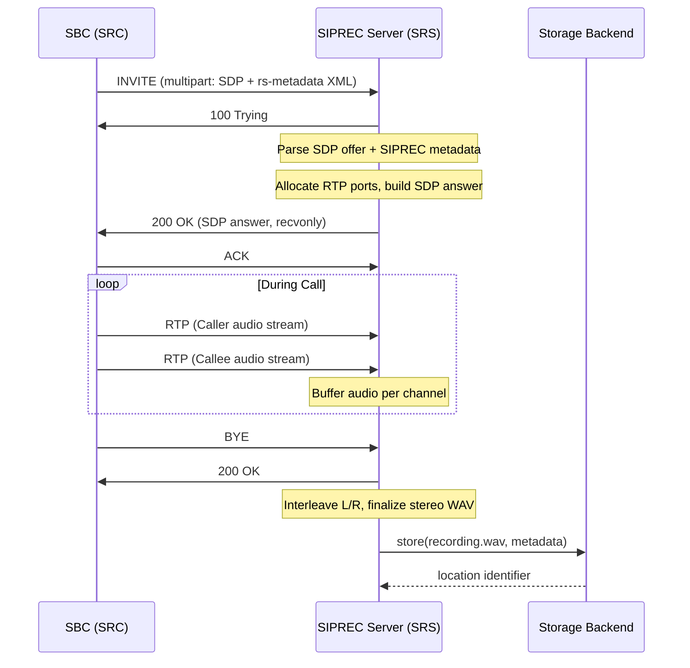

# SIPREC Recording Server

**A production-ready SIPREC (RFC 7865/7866) Session Recording Server with pluggable storage backends.**

Built by [Joshua Elson](https://github.com/joshelson) at **5060 Solutions**.

---

## Overview

This server acts as a **Session Recording Server (SRS)** per RFC 7865/7866. It receives SIPREC INVITEs from any compliant Session Border Controller (SBC) acting as a Session Recording Client (SRC), captures dual RTP audio streams (caller + callee), and writes stereo WAV recordings to one or more configurable storage backends.

### Key Features

- Full RFC compliance (RFC 3261 SIP, RFC 4566 SDP, RFC 7865/7866 SIPREC, RFC 2046 MIME, RFC 3550 RTP)
- Stereo WAV output (left = caller, right = callee) in 8kHz mu-law
- Pluggable storage architecture with four built-in backends
- SIPREC metadata parsing (participant identification, stream association)
- Multi-codec SDP negotiation with media-level connection addresses
- Concurrent session handling via async Rust (tokio)
- PCAP packet capture for debugging
- Zero unsafe code

## Architecture



### Call Flow



## Quick Start

### Build

```bash
cargo build --release
```

### Run

```bash
# Minimal (local storage only)
./target/release/siprec-server --local-ip 10.0.0.100

# With S3 upload
./target/release/siprec-server \
  --local-ip 10.0.0.100 \
  --s3-bucket my-recordings-bucket \
  --s3-prefix "siprec/2024/"

# With HTTP webhook
./target/release/siprec-server \
  --local-ip 10.0.0.100 \
  --http-url https://api.example.com/recordings \
  --http-auth "Bearer my-secret-token"

# Multiple backends simultaneously (local + S3 + webhook)
./target/release/siprec-server \
  --local-ip 10.0.0.100 \
  --s3-bucket my-bucket \
  --http-url https://api.example.com/recordings
```

### CLI Options

| Flag | Default | Description |
|------|---------|-------------|
| `--local-ip` | *(required)* | Local IP address for SDP answers |
| `--sip-port` | `5060` | SIP listen port |
| `--rtp-port-min` | `20000` | Start of RTP port range |
| `--rtp-port-max` | `30000` | End of RTP port range |
| `--recording-dir` | `./recordings` | Directory for WAV files |
| `--s3-bucket` | *(disabled)* | S3 bucket name (enables S3 backend) |
| `--s3-prefix` | `recordings/` | S3 key prefix |
| `--s3-delete-local` | `false` | Delete local file after S3 upload |
| `--http-url` | *(disabled)* | Webhook URL (enables HTTP backend) |
| `--http-method` | `post` | HTTP method (`post` or `put`) |
| `--http-auth` | *(none)* | Authorization header value |
| `--http-delete-local` | `false` | Delete local file after HTTP upload |

### Logging

Control log verbosity via the `RUST_LOG` environment variable:

```bash
RUST_LOG=debug ./target/release/siprec-server --local-ip 10.0.0.100
RUST_LOG=siprec_server=trace ./target/release/siprec-server --local-ip 10.0.0.100
```

## Pluggable Storage Architecture

Storage is abstracted behind the `StorageBackend` trait. The server ships with four built-in backends, and you can implement your own.

### Built-in Backends

| Backend | Description | Use Case |
|---------|-------------|----------|
| **LocalStorage** | Keeps recordings on the local filesystem | Development, NFS mounts, local processing |
| **S3Storage** | Uploads to Amazon S3 with metadata tags | AWS deployments, long-term archival |
| **HttpStorage** | POST/PUT to any HTTP endpoint | Webhooks, custom APIs, third-party integrations |
| **MultiStorage** | Forwards to multiple backends | Local + S3, redundancy, fan-out processing |

### Implementing a Custom Backend

```rust
use async_trait::async_trait;
use siprec_server::storage::{StorageBackend, RecordingInfo, StorageResult};
use std::path::Path;

pub struct MyCustomStorage {
    // your config fields
}

#[async_trait]
impl StorageBackend for MyCustomStorage {
    async fn store(&self, file_path: &Path, info: &RecordingInfo) -> StorageResult {
        // Upload, copy, or process the WAV file at file_path.
        // info contains: call_id, caller, callee, duration_ms, started_at
        Ok("my-custom://location".to_string())
    }

    fn name(&self) -> &str {
        "my-custom"
    }
}
```

Then wire it into the server:

```rust
use std::sync::Arc;
use siprec_server::server::{ServerConfig, SiprecServer};
use siprec_server::storage::StorageBackend;

let storage: Arc<dyn StorageBackend> = Arc::new(MyCustomStorage { /* ... */ });
let server = SiprecServer::new(config, storage);
server.run().await?;
```

### MultiStorage (Composite)

Write to multiple backends simultaneously:

```rust
use siprec_server::storage::{MultiStorage, LocalStorage, S3Storage, StorageBackend};

// Best-effort: succeeds if at least one backend succeeds
let storage = MultiStorage::new(vec![
    Box::new(LocalStorage),
    Box::new(s3_storage),
    Box::new(http_storage),
]);

// Strict: fails if any backend fails
let storage = MultiStorage::strict(vec![
    Box::new(LocalStorage),
    Box::new(s3_storage),
]);
```

## Project Structure

```
src/
  bin/siprec_server.rs   # CLI binary (clap)
  lib.rs                 # Library root
  error.rs               # Error types (thiserror)
  net.rs                 # AsyncUdpSocket trait + MockUdpSocket
  pcap.rs                # PCAP packet capture
  recording.rs           # Stereo WAV recorder
  session.rs             # RecordingSession (SIP dialog + RTP + recorder)
  server.rs              # Main server loop
  sip/
    mod.rs               # SIP module
    transport.rs         # UDP SIP transport
    message.rs           # SIP message builders (RFC 3261)
    sdp.rs               # SDP parsing + answer generation (RFC 4566)
  siprec/
    mod.rs               # SIPREC module
    metadata.rs          # RFC 7865 rs-metadata XML parser
    multipart.rs         # RFC 2046 multipart MIME parser
  rtp/
    mod.rs               # RTP module
    header.rs            # RTP header parser (RFC 3550)
    receiver.rs          # RTP stream receiver (recvonly)
  storage/
    mod.rs               # StorageBackend trait
    local.rs             # Local filesystem backend
    s3.rs                # Amazon S3 backend
    http.rs              # HTTP webhook backend
    multi.rs             # Composite multi-backend
```

## RFC Compliance

| RFC | Coverage |
|-----|----------|
| **RFC 3261** | SIP dialog handling: 100 Trying, 200 OK, BYE, Record-Route, Via, Allow, Server headers |
| **RFC 4566** | SDP parsing: multi-stream, multi-codec, media-level c=, direction attributes |
| **RFC 7865** | SIPREC metadata XML: participant/stream parsing with quick-xml |
| **RFC 7866** | SIPREC signaling: INVITE handling with multipart SDP + metadata |
| **RFC 2046** | Multipart MIME: line-based boundary detection, preamble/epilogue handling |
| **RFC 3550** | RTP: header parsing, CSRC, extensions, padding validation, SSRC tracking |

## Development

```bash
# Setup (install pre-commit hooks)
make setup

# Build
cargo build

# Test (105 tests)
cargo test

# Lint
cargo clippy -- -D warnings

# Format
cargo fmt

# Docs
RUSTDOCFLAGS="-Dwarnings" cargo doc --no-deps
```

## Tested SBC Compatibility

Designed to work with any RFC 7865/7866-compliant SBC, including:

- Sansay VSXi
- Oracle (Acme Packet) SBC
- Ribbon (GENBAND) SBC
- AudioCodes SBC
- Cisco CUBE

## License

This project is licensed under the **Business Source License 1.1 (BSL 1.1)**.

- **Non-commercial use**: Free and unrestricted
- **Commercial use**: Requires a paid license from 5060 Solutions

See [LICENSE](LICENSE) for the full license text.

For commercial licensing inquiries, contact Joshua Elson.

---

*Built with Rust by [5060 Solutions](https://github.com/joshelson)*
